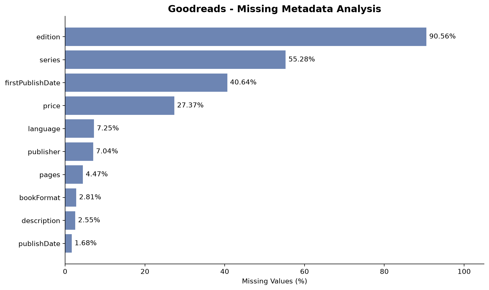
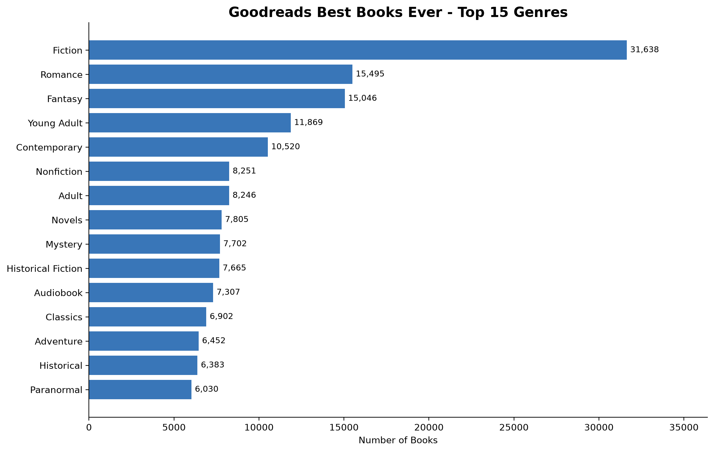
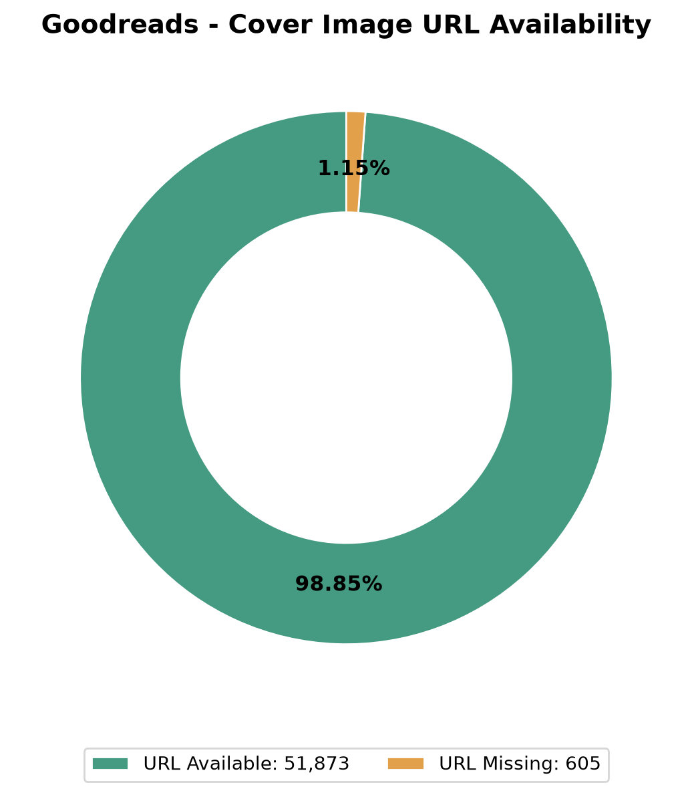
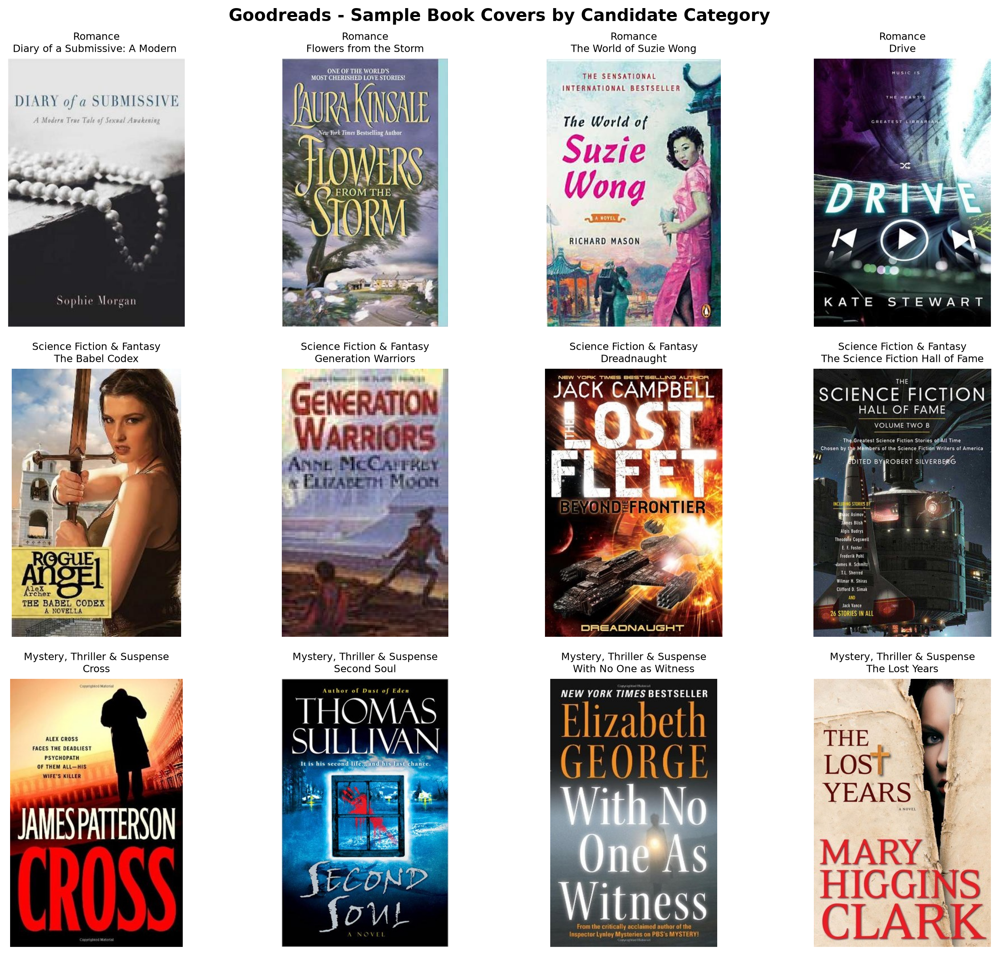

# Veri Seti İncelemesi: Goodreads Best Books Ever

## 1. Veri Setine Genel Bakış

Bu çalışmada, kitap kapağından tür/kategori sınıflandırması projesinin ikinci veri kaynağı olarak Goodreads Best Books Ever Dataset (v1.0.0) incelenmiştir.

- **Veri seti:** Goodreads Best Books Ever
- **Kaynak:** Zenodo
- **Toplam kayıt:** 52.478
- **Sütun sayısı:** 25
- **Benzersiz tür etiketi:** 982

Veri seti; kitap başlığı, yazar, tür etiketleri, yayın bilgileri, puanlar ve kapak görseli bağlantıları gibi metadata alanlarından oluşmaktadır.

BookCover30'dan farklı olarak kapak görüntüleri CSV dosyasında doğrudan bulunmamakta,URL'ler aracılığıyla eri şilebilir durumdadır.

Bu veri setinin projedeki amacı, BookCover30 üzerinde eğitilecek görüntü sınıflandırma modellerinin farklı kaynaktan gelen kitap kapakları üzerindeki genellenebilirliğini incelemektir.

## 2. Metadata ve Eksik Değer Analizi

Veri setindeki 25 sütun eksik değerler açısından incelenmiştir.

### 2.1. Eksik Metadata Alanları

| Alan | Eksik Kayıt | Eksik Oranı |
|---|---:|---:|
| edition | 47.523 | %90,56 |
| series | 29.008 | %55,28 |
| firstPublishDate | 21.326 | %40,64 |
| price | 14.365 | %27,37 |
| language | 3.806 | %7,25 |
| publisher | 3.696 | %7,04 |
| pages | 2.347 | %4,47 |
| bookFormat | 1.473 | %2,81 |
| description | 1.338 | %2,55 |
| publishDate | 880 | %1,68 |
| coverImg | 605 | %1,15 |

Kitap kimliği (`bookId`), başlık (`title`) ve tür (`genres`) sütunlarında pandas tarafından eksik değer olarak değerlendirilen kayıt bulunmamıştır.

Bununla birlikte, tür listesinin boş olması ile eksik değer bulunması aynı durum değildir. Bu nedenle tür alanları ayrıca analiz edilmiştir.

### 2.2. Eksik Metadata Görselleştirmesi

*Şekil 1. Goodreads Best Books Ever veri setinde en yüksek eksik değer oranına sahip 10 metadata alanı.*

Eksik değerlerin özellikle baskı bilgisi, seri bilgisi ve ilk yayın tarihi alanlarında yoğunlaştığı görülmüştür.

Bu çalışmada temel model girdisi kapak görüntüsü olduğundan, bu metadata alanlarındaki eksikliklerin doğrudan görüntü sınıflandırma modelinin eğitimini etkilemesi beklenmemektedir.

## 3. Kitap Türlerinin Analizi

Veri setindeki `genres` alanı incelendiğinde 982 benzersiz tür etiketi belirlenmiştir.

Goodreads veri setinde kitaplar birden fazla tür etiketi taşıyabilmektedir. Bu nedenle veri seti çok etiketli bir kategori yapısına sahiptir.

### 3.1. En Yaygın Türler

| Tür | Kayıt Sayısı |
|---|---:|
| Fiction | 31.638 |
| Romance | 15.495 |
| Fantasy | 15.046 |
| Young Adult | 11.869 |
| Contemporary | 10.520 |
| Nonfiction | 8.251 |
| Adult | 8.246 |
| Novels | 7.805 |
| Mystery | 7.702 |
| Historical Fiction | 7.665 |

### 3.2. Tür Dağılımı Görselleştirmesi

*Şekil 2. Goodreads Best Books Ever veri setindeki en yaygın 15 tür etiketi.*

En yaygın türlerin Fiction, Romance ve Fantasy olduğu görülmektedir.

Bir kitap birden fazla tür etiketi taşıyabildiğinden, türlere ait kayıt sayılarının toplamı veri setindeki toplam kitap sayısını aşabilmektedir.

## 4. Kapak Görseli Bağlantılarının Analizi

Kitap kapağı bağlantıları `coverImg` sütunu üzerinden incelenmiştir.

- Toplam kayıt sayısı: 52.478
- Kapak URL'si bulunan kayıt: 51.873
- Kapak URL'si eksik kayıt: 605
- Kapak URL'si bulunma oranı: %98,85

### 4.1. Kapak URL Dağılımı

*Şekil 3. Goodreads kayıtlarında kapak görseli URL'sinin bulunma durumu.*

Veri setindeki kayıtların büyük çoğunluğunda kapak görseli bağlantısı bulunmaktadır.

Ancak URL alanının dolu olması, bağlantının hâlen çalıştığını veya görselin başarıyla indirilebildiğini garanti etmemektedir.

Gerçek indirilebilir görüntü sayısı, otomatik indirme ve görüntü doğrulama işlemlerinden sonra belirlenecektir.

## 5. Veri Kalitesi ve Tutarlılık Kontrolleri

Metadata analizi sonrasında tür listelerinin kullanılabilirliği, kapak URL'lerinin biçimi ve tekrarlanan kitap kimlikleri ayrıca incelenmiştir.

### 5.1. Tür ve URL Kontrolleri

| Kontrol | Sonuç |
|---|---:|
| Toplam kayıt | 52.478 |
| Boş veya ayrıştırılamayan tür listesi | 4.623 |
| Geçerli URL biçimine sahip kayıt | 51.873 |
| Hem tür listesi hem URL koşulunu sağlayan kayıt | 47.571 |
| Tekrarlanan kitap kimliği (ilk kayıt hariç) | 54 |

`genres` sütununda eksik değer görünmemesine rağmen 4.623 kaydın boş veya ayrıştırılamayan tür listesine sahip olduğu belirlenmiştir.

Bu sonuç, metadata alanlarının yalnızca `NaN` değerleri üzerinden kontrol edilmesinin yeterli olmadığını göstermektedir.

47.571 kayıt, tür listesi ve URL biçimi açısından sonraki işlemler için aday olarak belirlenmiştir.

### 5.2. Tekrarlanan Kayıtlar

`bookId` sütununda ilk kayıtlar hariç 54 tekrar tespit edilmiştir.

Tekrarlanan kimliklerin tamamen aynı kitabı veya farklı baskıları temsil edip etmediği henüz kesinleştirilmemiştir.

Bu kayıtlar, veri hazırlama aşamasında ayrıca değerlendirilecektir.

## 6. BookCover30 ile Kategori Eşleştirme Analizi

BookCover30 veri setinde 30 sabit kategori bulunurken Goodreads veri setinde 982 farklı tür etiketi bulunmaktadır.

İlk eşleştirme analizi için altı Goodreads türü dört BookCover30 kategorisiyle ilişkilendirilmiştir.

| Goodreads Türü | BookCover30 Kategorisi | Sınıf ID |
|---|---|---:|
| Mystery | Mystery, Thriller & Suspense | 17 |
| Thriller | Mystery, Thriller & Suspense | 17 |
| Romance | Romance | 22 |
| Fantasy | Science Fiction & Fantasy | 24 |
| Science Fiction | Science Fiction & Fantasy | 24 |
| Young Adult | Teen & Young Adult | 27 |

### 6.1. İlk Eşleştirme Sonuçları

47.571 aday kayıt üzerinde gerçekleştirilen ilk eşleştirme analizinde:

- Eşleşen kategori bulunamayan kayıt: 16.674
- Tek kategoriyle eşleşen kayıt: 15.367
- Birden fazla kategoriyle eşleşen kayıt: 15.530

Tek kategoriyle eşleşen kayıtların dağılımı:

| BookCover30 Kategorisi | Aday Kayıt |
|---|---:|
| Mystery, Thriller & Suspense | 3.418 |
| Romance | 5.587 |
| Science Fiction & Fantasy | 4.698 |
| Teen & Young Adult | 1.664 |
| Toplam | 15.367 |

### 6.2. Eşleştirmelerin Değerlendirilmesi

Her kategoriden rastgele 10 kayıt seçilerek toplam 40 kitap için başlık ve tür bilgileri incelenmiştir.

Mystery, Thriller & Suspense, Romance ve Science Fiction & Fantasy kategorilerindeki örneklerin önemli bir kısmı önerilen kategorilerle uyumlu görünmektedir.

Bununla birlikte, bazı kitapların tür bilgileri birden fazla kategoriyle ilişkili olabildiğinden otomatik eşleştirmelerin kesin doğru etiketler olarak kabul edilmemesi gerektiği görülmüştür.

Özellikle Teen & Young Adult kategorisinde çocuk kitapları ve farklı yaş gruplarına yönelik eserlerin bulunması nedeniyle etiket belirsizliği daha belirgindir.

Bu nedenle ilk dış değerlendirme veri kümesinde aşağıdaki üç kategoriye öncelik verilmesi planlanmıştır:

1. Mystery, Thriller & Suspense
2. Romance
3. Science Fiction & Fantasy

Teen & Young Adult kategorisi ilk aşamada değerlendirme dışında tutulacaktır.

## 7. Genel Değerlendirme ve Sonraki Adımlar

Goodreads Best Books Ever veri seti, farklı kaynaktan gelen kitap kapaklarını incelemek açısından potansiyel olarak uygun bir ikinci veri kaynağıdır.

Ancak BookCover30 ile Goodreads arasında kategori yapısı bakımından önemli farklılıklar bulunmaktadır.

Veri setinin doğrudan model eğitimine veya performans değerlendirmesine alınması yerine, etiket eşleştirmesi ve görüntü doğrulama işlemlerinin tamamlanması gerekmektedir.

Sonraki aşamalarda:

1. Kategori eşleştirmeleri daha güvenilir hâle getirilecektir.
2. İndirilecek kapak görüntüleri için kayıt listesi oluşturulacaktır.
3. Görseller otomatik olarak indirilecektir.
4. İndirilen görsellerin boyutları, formatları ve bütünlüğü kontrol edilecektir.
5. Uygun kayıtlar dış değerlendirme için hazırlanacaktır.
6. Mümkün olduğunda etiketler doğrulanacak ve olası veri örtüşmeleri incelenecektir.

Bu aşamada yalnızca metadata analizi ve ilk kategori eşleştirme çalışmaları tamamlanmıştır. Görsel indirme ve nihai dış değerlendirme henüz gerçekleştirilmemiştir.

## 8. İndirilen Görüntülerin Kalite Analizi

Goodreads Best Books Ever veri setindeki kapak görseli bağlantıları kullanılarak otomatik görüntü indirme işlemi gerçekleştirilmiştir.

### 8.1. Görsel İndirme Sonuçları

| Özellik | Sonuç |
|---|---:|
| Toplam kitap kaydı | 52.478 |
| Kapak URL'si bulunan kayıt | 51.873 |
| Başarıyla indirilen görüntü | 51.870 |
| İndirilemeyen görüntü | 3 |
| İndirme başarı oranı | %99,994 |
| Bozuk veya okunamayan görüntü | 0 |

İndirme işlemi sırasında görseller RGB formatına dönüştürülerek JPEG olarak kaydedilmiştir.

İndirme sonrasında bütün görüntüler PIL kütüphanesi kullanılarak incelenmiştir.

### 8.2. Görüntü Özellikleri

- Toplam görüntü sayısı: 51.870
- Renk modu: RGB
- Dosya formatı: JPEG
- Görüntü boyutları: Değişken
- Bozuk veya okunamayan dosya sayısı: 0

En sık karşılaşılan görüntü boyutları arasında 317×475, 316×475 ve 314×475 piksel bulunmaktadır.

BookCover30 veri setinden farklı olarak Goodreads görüntülerinin boyutları sabit değildir. Model değerlendirmesi öncesinde görüntülerin ortak giriş boyutuna dönüştürülmesi planlanmaktadır.

### 8.3. Örnek Kapak Görüntüleri

*Şekil 4. Goodreads veri setinden üç aday kategori için seçilen 12 kitap kapağı.*

Örnek görüntüler, kitap kapaklarının farklı tasarım, renk ve tipografi özelliklerine sahip olduğunu göstermektedir.

Kategori isimleri Goodreads türlerinden otomatik olarak eşleştirilmiştir. Bu etiketlerin doğruluğu henüz kesinleştirilmemiştir.

### 8.4. Genel Değerlendirme

Goodreads veri setinin görüntü indirme ve temel dosya bütünlüğü kontrolleri tamamlanmıştır.

İndirilen 51.870 görüntüde bozuk veya okunamayan dosya tespit edilmemiştir.

Veri seti, BookCover30 üzerinde eğitilecek modellerin farklı kaynaklardan gelen kitap kapaklarında değerlendirilmesi için kullanılabilecek bir görsel kaynak hâline getirilmiştir.

Nihai değerlendirme öncesinde kategori eşleştirmelerinin güvenilirliği ve veri setleri arasındaki olası kitap/görsel örtüşmeleri ayrıca incelenecektir.
