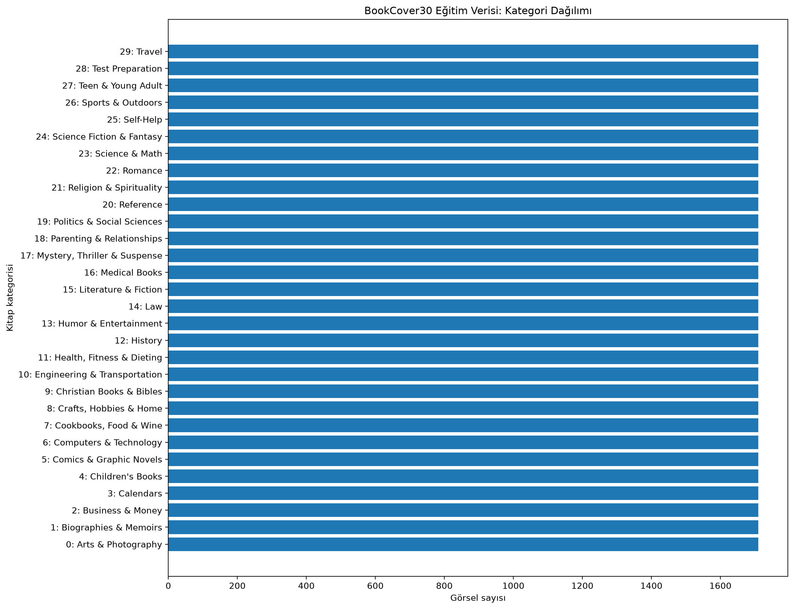

# Veri Seti İncelemesi: BookCover30

## 1. Veri Setine Genel Bakış

Bu projede kitap kapak görüntülerinden kitap kategorilerini
tahmin etmek amacıyla BookCover30 veri seti kullanılmaktadır.

- **Toplam görsel sayısı:** 57.000
- **Eğitim kümesi:** 51.300 görsel (%90)
- **Test kümesi:** 5.700 görsel (%10)
- **Kategori sayısı:** 30
- **Görsel boyutları:** 224 × 224 piksel
- **Renk formatı:** RGB

## 2. Veri Bütünlüğü Kontrolleri

- Etiket dosyalarındaki 57.000 dosya adı mevcut görsellerle eşleşmiştir.
- Dosya adı eşleştirmesinde eksik görsel bulunmamıştır.
- Eğitim etiketlerinde tekrarlanan dosya adı bulunmamıştır.
- Test etiketlerinde tekrarlanan dosya adı bulunmamıştır.
- Eğitim ve test kümeleri arasında ortak dosya adı bulunmamıştır.
- Görsel incelemesinde okunamayan veya bozuk dosya tespit edilmemiştir.

## 3. Kategori Dağılımı

- Her kategoride 1.710 eğitim görseli bulunmaktadır.
- Her kategoride 190 test görseli bulunmaktadır.
- Her kategoride toplam 1.900 görsel bulunmaktadır.

Bu sonuçlar, veri setinin sınıf sayıları bakımından dengeli olduğunu
göstermektedir. Ancak dengeli dağılım, modelin bütün kategorilerde
eşit başarı göstereceği anlamına gelmez.

### Eğitim Kümesinin Kategori Dağılımı

## 4. İlk Değerlendirme

Görsellerin aynı boyutta ve RGB formatında olması, model eğitiminde
standart bir giriş boyutu kullanılmasını kolaylaştırmaktadır.

Bir sonraki aşamada görsellerin ön işleme gereksinimleri,
kategori etiketleri ve kullanılacak sınıflandırma modelleri
değerlendirilecektir.
## 5. Metadata Kalitesi ve Eksik Değer Analizi

BookCover30 veri setine ait eğitim ve test metadata dosyaları eksik değerler ve etiket tutarlılığı açısından incelenmiştir.

Eğitim kümesindeki 51.300 kaydın 3.439'unda (%6,70), test kümesindeki 5.700 kaydın ise 397'sinde (%6,96) yazar bilgisi eksiktir.

Buna karşılık kitap kimliği, dosya adı, görsel URL'si, kitap başlığı, sayısal metadata alanı ve kategori bilgilerinde eksik değer tespit edilmemiştir.

Etiket dosyaları ile CSV metadata dosyaları karşılaştırıldığında:

- Eğitim ve test kümelerinde kategori bilgisi bulunmayan kayıt tespit edilmemiştir.
- Her iki kümede de aynı sayısal sınıf etiketinin birden fazla kategori adına karşılık geldiği bir durum görülmemiştir.
- Etiket ve kategori bilgilerinin mevcut eşleşmelerinde tutarsızlık saptanmamıştır.

**Ön işleme kararı:** Bu projede sınıflandırma modelleri kitap kapağı görüntülerini girdi olarak kullanacaktır. Yazar bilgisi model girdisi olmadığından, eksik yazar bilgileri nedeniyle herhangi bir görüntü veri setinden çıkarılmayacak veya eksik alanlar yapay olarak doldurulmayacaktır.

Bu bulgular, veri setinin planlanan görüntü tabanlı sınıflandırma çalışması için uygun olduğunu desteklemektedir.