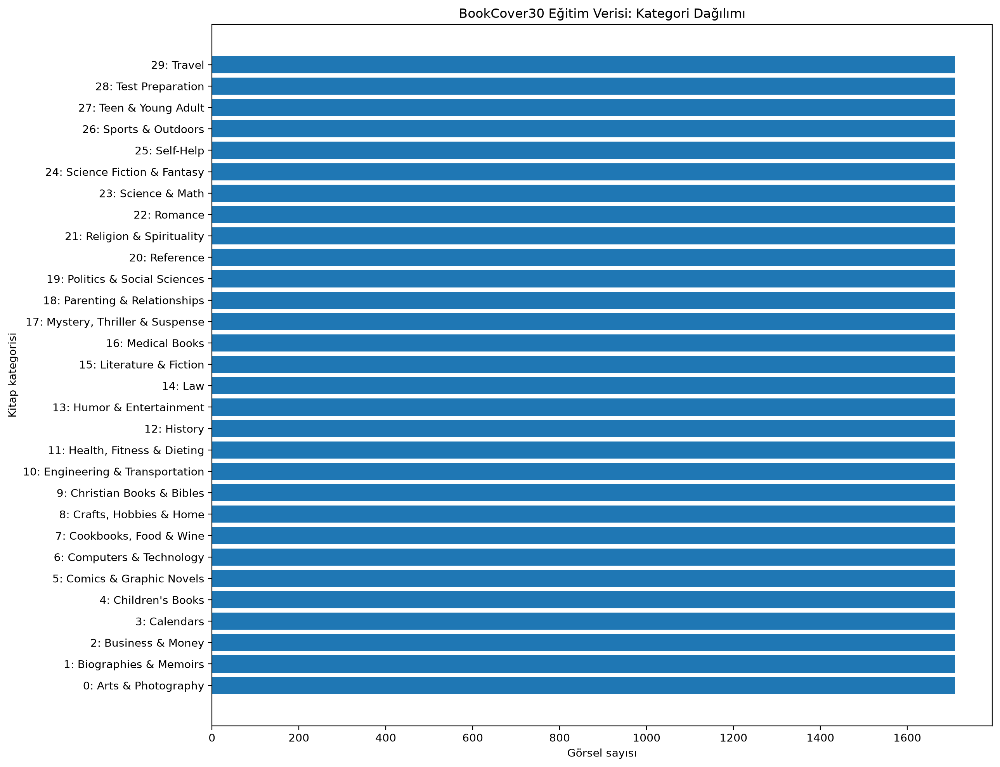
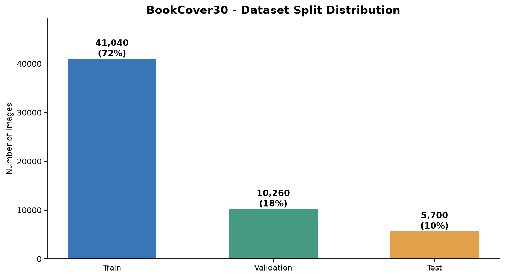
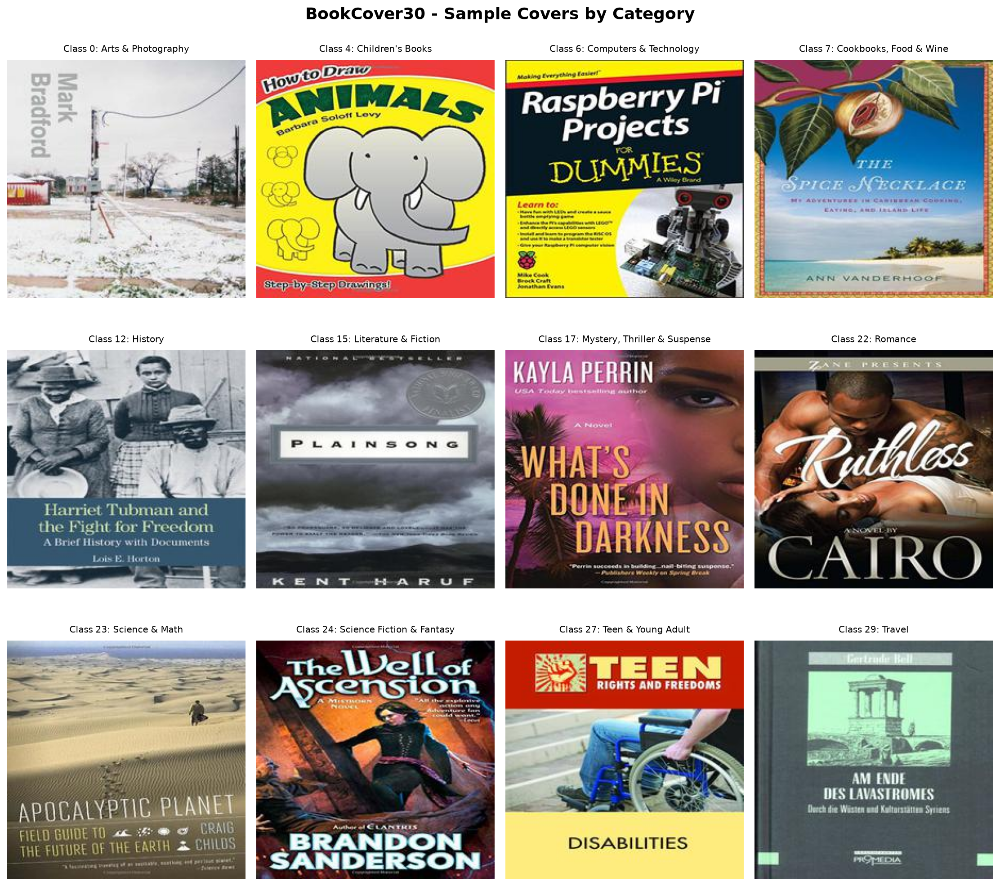
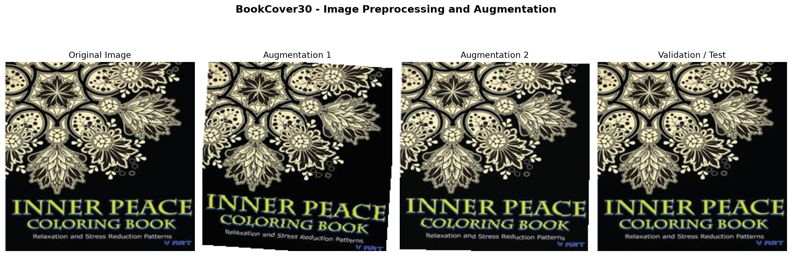

# Veri Seti İncelemesi: BookCover30

## 1. Veri Setine Genel Bakış

Bu projede kitap kapak görüntülerinden kitap kategorilerini
tahmin etmek amacıyla BookCover30 veri seti kullanılmaktadır.

- **Toplam görsel sayısı:** 57.000
- **Eğitim kümesi:** 51.300 görsel (%90)
- **Test kümesi:** 5.700 görsel (%10)
- **Kategori sayısı:** 30
- **Görsel boyutları:** 224 × 224 piksel
- **Renk formatı:** RGB

## 2. Veri Bütünlüğü Kontrolleri

- Etiket dosyalarındaki 57.000 dosya adı mevcut görsellerle eşleşmiştir.
- Dosya adı eşleştirmesinde eksik görsel bulunmamıştır.
- Eğitim etiketlerinde tekrarlanan dosya adı bulunmamıştır.
- Test etiketlerinde tekrarlanan dosya adı bulunmamıştır.
- Eğitim ve test kümeleri arasında ortak dosya adı bulunmamıştır.
- Görsel incelemesinde okunamayan veya bozuk dosya tespit edilmemiştir.

## 3. Kategori Dağılımı

- Her kategoride 1.710 eğitim görseli bulunmaktadır.
- Her kategoride 190 test görseli bulunmaktadır.
- Her kategoride toplam 1.900 görsel bulunmaktadır.

Bu sonuçlar, veri setinin sınıf sayıları bakımından dengeli olduğunu
göstermektedir. Ancak dengeli dağılım, modelin bütün kategorilerde
eşit başarı göstereceği anlamına gelmez.

### Eğitim Kümesinin Kategori Dağılımı

## 4. İlk Değerlendirme

Görsellerin aynı boyutta ve RGB formatında olması, model eğitiminde
standart bir giriş boyutu kullanılmasını kolaylaştırmaktadır.

Bir sonraki aşamada görsellerin ön işleme gereksinimleri,
kategori etiketleri ve kullanılacak sınıflandırma modelleri
değerlendirilecektir.

## 5. Metadata Kalitesi ve Eksik Değer Analizi

BookCover30 veri setinin eğitim ve test CSV dosyaları, eksik değerler ve etiket tutarlılığı açısından incelenmiştir.

### 5.1. Eksik Değer Analizi

- Eğitim kümesindeki 51.300 kaydın 3.439'unda (%6,70) yazar bilgisi eksiktir.
- Test kümesindeki 5.700 kaydın 397'sinde (%6,96) yazar bilgisi eksiktir.
- Kitap kimliği, dosya adı, görsel URL'si, kitap başlığı ve kategori alanlarında eksik değer bulunmamıştır.

Proje kapsamında yalnızca kitap kapağı görüntüleri model girdisi olarak kullanılacağından, eksik yazar bilgileri model eğitimini doğrudan etkilemeyecektir. Bu nedenle eksik yazar bilgileri doldurulmamış ve ilgili kayıtlar veri setinden çıkarılmamıştır.

### 5.2. Etiket Tutarlılığı

- Eğitim ve test kümelerinde kategori bilgisi bulunmayan kayıt yoktur.
- Aynı sayısal sınıf etiketinin birden fazla kategori adına karşılık geldiği bir durum tespit edilmemiştir.
- CSV dosyalarındaki kategori bilgileri ile etiket dosyaları arasında incelenen eşleşmelerde tutarsızlık bulunmamıştır.

Bu sonuçlar, veri setinin etiket tutarlılığı açısından görüntü sınıflandırma çalışmasına uygun olduğunu göstermektedir.

## 6. Eğitim, Doğrulama ve Test Kümelerinin Oluşturulması

BookCover30 veri seti başlangıçta 51.300 eğitim ve 5.700 test görüntüsünden oluşmaktadır.

Modelin eğitim sırasında performansını değerlendirebilmek amacıyla mevcut eğitim kümesi, `train_test_split` yöntemi kullanılarak yeniden bölünmüştür.

Bölme işleminde:

- `test_size=0.20` kullanılmıştır.
- `random_state=42` ile tekrarlanabilirlik sağlanmıştır.
- `stratify` parametresiyle sınıfların dengeli dağılımı korunmuştur.
- Orijinal test kümesi değiştirilmemiştir.

### 6.1. Veri Kümesi Dağılımı

| Veri Kümesi | Görüntü Sayısı | Oran |
|---|---:|---:|
| Eğitim (Train) | 41.040 | %72 |
| Doğrulama (Validation) | 10.260 | %18 |
| Test | 5.700 | %10 |
| Toplam | 57.000 | %100 |

Her üç veri kümesinde de 30 sınıf bulunmaktadır.

- Eğitim kümesinde sınıf başına 1.368 görüntü bulunmaktadır.
- Doğrulama kümesinde sınıf başına 342 görüntü bulunmaktadır.
- Test kümesinde sınıf başına 190 görüntü bulunmaktadır.

Yapılan kontroller sonucunda eğitim ve doğrulama kümeleri arasında, ayrıca doğrulama ve test kümeleri arasında ortak dosya adı bulunmamıştır.

### 6.2. Veri Kümesi Dağılım Grafiği

*Şekil: BookCover30 veri setinin eğitim, doğrulama ve test kümelerine göre dağılımı.*

Bu dağılım, model eğitimi ve performans değerlendirmesi için ayrı veri kümeleri oluşturulmasını sağlamaktadır.

## 7. Örnek Kitap Kapaklarının Görselleştirilmesi

Veri setinin görsel özelliklerini incelemek amacıyla 12 farklı kategoriden birer kitap kapağı seçilerek görselleştirilmiştir.

*Şekil: BookCover30 veri setinden seçilen 12 farklı kategoriye ait örnek kitap kapakları.*

Görseller incelendiğinde kategoriler arasında renk, yazı tipi, kapak düzeni ve görsel içerik açısından farklılıklar bulunduğu görülmektedir.

Bununla birlikte bazı kategorilerin benzer görsel özellikler taşıyabilmesi, yalnızca kapak görüntülerinden kategori tahmini yapılmasını zorlaştırabilir.

## 8. Görüntü Ön İşleme ve Veri Artırma

Kitap kapağı görüntülerini derin öğrenme modellerine uygun hâle getirmek amacıyla PyTorch ve Torchvision kütüphaneleri kullanılarak ön işleme dönüşümleri hazırlanmıştır.

### 8.1. Görüntü Ön İşleme İşlemleri

Uygulanan temel işlemler şunlardır:

- Görüntülerin 224×224 piksel boyutunda hazırlanması.
- Görüntülerin RGB formatında kullanılması.
- Görüntülerin PyTorch Tensor formatına dönüştürülmesi.
- ImageNet ortalama ve standart sapma değerleriyle normalizasyon uygulanması.

Normalizasyonda kullanılan değerler:

- Mean: [0.485, 0.456, 0.406]
- Standard Deviation: [0.229, 0.224, 0.225]

### 8.2. Veri Artırma (Data Augmentation)

Modelin farklı görsel koşullara uyum sağlayabilmesi amacıyla eğitim kümesi için veri artırma dönüşümleri tanımlanmıştır.

Kullanılan yöntemler:

- RandomRotation: ±5 derece rastgele döndürme.
- ColorJitter: Parlaklık, kontrast ve renk doygunluğunda küçük değişiklikler.

Kitap kapaklarında metin bulunduğu için yatay çevirme işlemi tercih edilmemiştir.

Doğrulama ve test kümelerinde rastgele veri artırma kullanılmamıştır. Bu kümeler için yalnızca boyutlandırma, Tensor dönüşümü ve normalizasyon tanımlanmıştır.

### 8.3. Ön İşleme Sonuçlarının Görselleştirilmesi

Ön işleme dönüşümleri örnek bir kitap kapağı üzerinde uygulanmış ve elde edilen görüntüler karşılaştırılmıştır.

*Şekil: Orijinal kitap kapağı, iki farklı veri artırma örneği ve doğrulama/test dönüşümünün karşılaştırılması.*

Görselleştirme sırasında normalizasyon işlemi tersine çevrilerek görüntülerin doğru renklerle gösterilmesi sağlanmıştır.

Elde edilen sonuçlarda hafif döndürme ve renk değişikliklerinin kitabın temel görsel özelliklerini büyük ölçüde koruduğu gözlemlenmiştir.

### 8.4. Ön İşleme Sonrası Kontroller

Örnek görüntü üzerinde gerçekleştirilen testlerde:

- Orijinal görüntü boyutu: 224×224
- Dönüştürülmüş Tensor boyutu: (3, 224, 224)
- Tensor veri tipi: float32

olarak doğrulanmıştır.

Bu sonuçlar, tanımlanan görüntü dönüşümlerinin örnek veri üzerinde başarıyla çalıştığını göstermektedir.

Bir sonraki aşamada bu dönüşümler PyTorch Dataset ve DataLoader yapılarına bağlanarak eğitim, doğrulama ve test verilerinin model eğitimine uygun şekilde yüklenmesi sağlanacaktır.
 
## 9. PyTorch Dataset ve DataLoader Hazırlığı

Görüntü sınıflandırma modellerinin eğitiminde kullanılmak üzere PyTorch kütüphanesi ile özel bir Dataset sınıfı oluşturulmuştur.

### 9.1. Dataset Yapısı

Oluşturulan `BookCoverDataset` sınıfı aşağıdaki işlemleri gerçekleştirmektedir:

- Kitap kapağı görüntülerini dosya yolundan yükleme.
- Görüntüleri RGB formatına dönüştürme.
- Eğitim veya değerlendirme için tanımlanan ön işleme dönüşümlerini uygulama.
- Her görüntüyü ilgili sayısal kategori etiketiyle birlikte döndürme.

Bu yapı kullanılarak eğitim, doğrulama ve test veri kümeleri hazırlanmıştır.

### 9.2. DataLoader Yapısı

Görüntülerin gruplar hâlinde yüklenebilmesi için PyTorch DataLoader kullanılmıştır.

- Batch size: 32
- Eğitim kümesinde shuffle: True
- Doğrulama ve test kümelerinde shuffle: False
- Num workers: 0

Eğitim verilerinde karıştırma işlemi kullanılarak görüntülerin farklı sıralamalarla modele sunulması amaçlanmıştır.

### 9.3. Veri Yükleme Kontrolleri

DataLoader yapıları üzerinde gerçekleştirilen testlerde görüntülerin ve etiketlerin beklenen biçimde yüklendiği doğrulanmıştır.

Bir batch için elde edilen sonuçlar:

- Görüntü Tensor boyutu: (32, 3, 224, 224)
- Etiket Tensor boyutu: (32,)
- Görüntü veri tipi: torch.float32
- Veri setindeki sınıf etiketleri: 0–29

Böylece görüntülerin ön işleme dönüşümlerinden geçirilerek model eğitimine uygun Tensor biçiminde yüklenebildiği gösterilmiştir.

Bu aşamada herhangi bir derin öğrenme modeli eğitilmemiştir. Model mimarilerinin oluşturulması ve eğitilmesi sonraki proje aşamalarında gerçekleştirilecektir.
